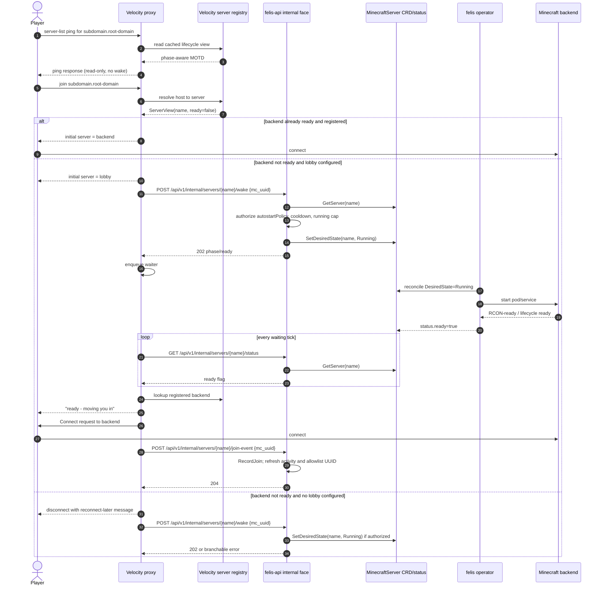
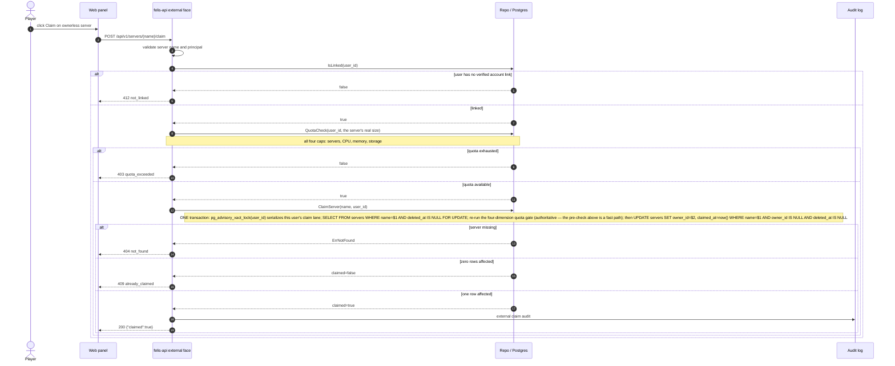
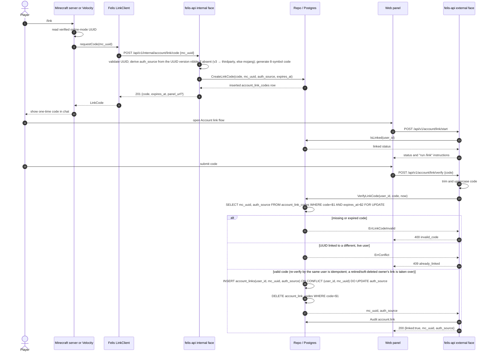

# Sequence diagrams {#sequence-diagrams}

This page shows three Felis flows that span several components as sequence diagrams: waking a sleeping server when a player joins, claiming an ownerless server in the panel, and linking a game account to a panel account. The request and response schemas of each endpoint are in the [API reference](/en/reference/api). It is for developers who need the order of messages between components.

## Join and wake {#join-and-wake}

When a player pings the server list, the game proxy reads only its cache and never wakes a server. When the player joins, the game proxy finds the target server by hostname: a ready server is joined directly; otherwise the game proxy requests a wake, holds the player in the lobby, polls the server's status, transfers the player once the server is ready, and reports the join. Without a lobby, the player is disconnected with a reconnect-later message, and the wake request is still sent.

The diagram starts after the player has been authenticated; a player who has not linked an account passes through the login space first; see [Login space image](/en/reference/limbo#login-flow).

## Claim a server {#claim}

When a player claims an ownerless server in the panel, felis-api first confirms that the account has a linked game profile, then checks the four quotas (servers, CPU, memory, storage) against the server's actual size. The claim completes in a single database transaction: it takes a per-user lock, locks the server row, runs the quota check again, and writes the ownership only if the server is still ownerless. The check inside the transaction decides the outcome; the quota check before it only returns errors early.

## Account linking {#account-link}

When a player runs `/link` in the game, the plugin reads the verified online-mode UUID and asks felis-api to mint a one-time 8-character bind code, which it shows in chat. When no authentication source is given, felis-api derives it from the UUID version: a version 3 UUID is treated as a third-party authentication source, anything else as Mojang. The player then submits the code in the panel; felis-api trims surrounding whitespace, converts it to upper case and checks it. A valid code writes the link and deletes the code; repeating the verification as the same user creates no duplicate, and the link of a disabled or deleted user is taken over. See [Player access](/en/guide/players#account-linking) for how players use it.

