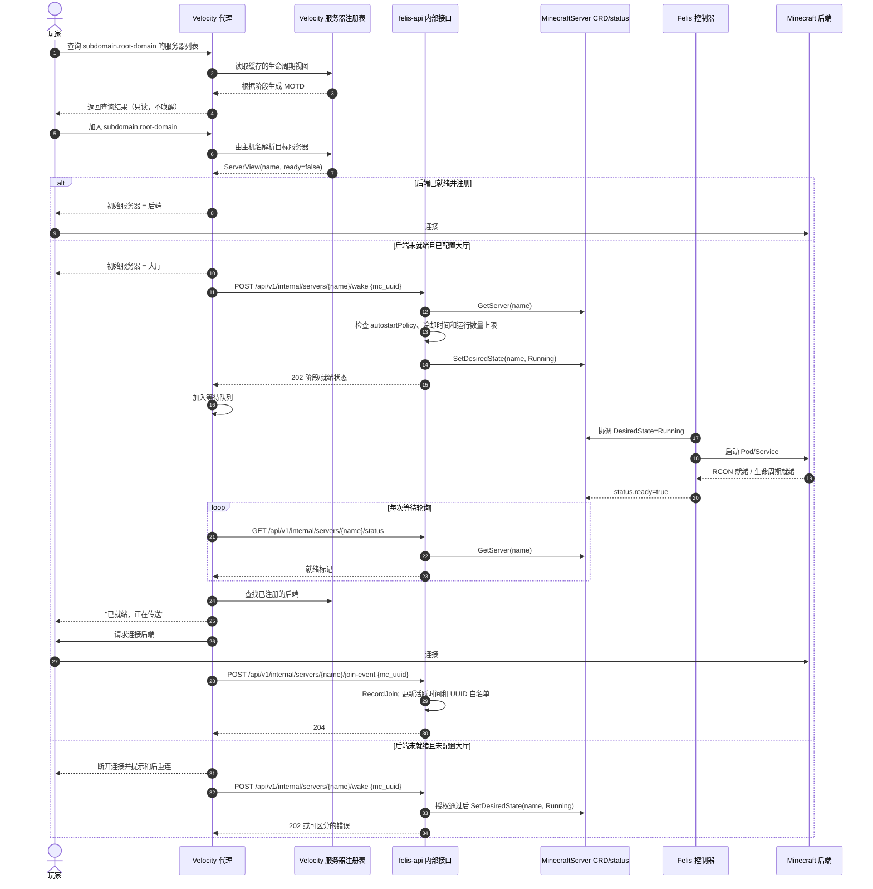
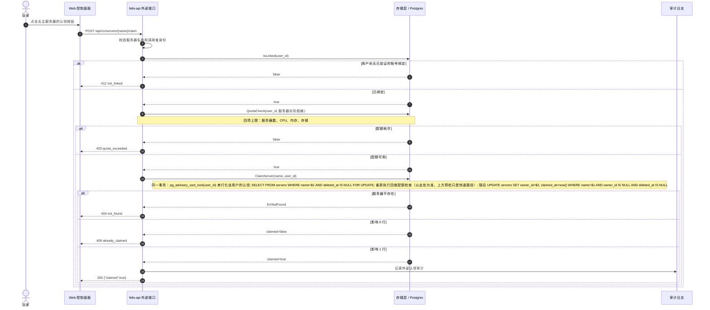
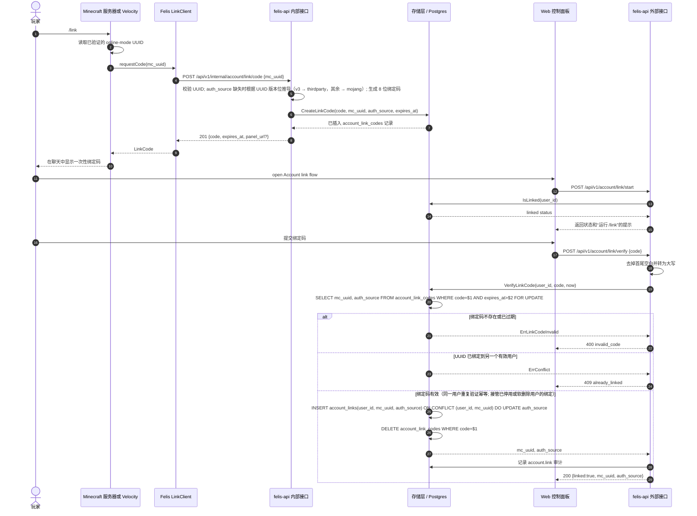

# 时序图 {#felis-sequence-diagrams}

本文收录规范第 28 节要求、且不由 OpenAPI 定义覆盖的时序图。

## 第 28 节 #9：查询 → 进服 → 唤醒 → 就绪 → 传送 {#section-28-9-ping-to-join-to-wake-to-ready-to-teleport}

## 第 28 节 #11：认领事务 {#section-28-11-claim-transaction}

## 第 28 节 #12：账号绑定与 /link 流程 {#section-28-12-account-binding-link-flow}

